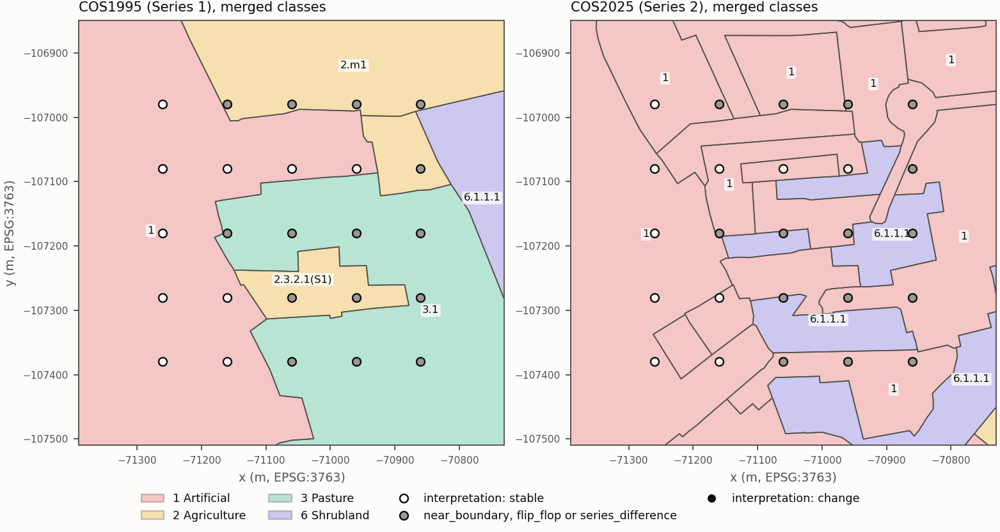
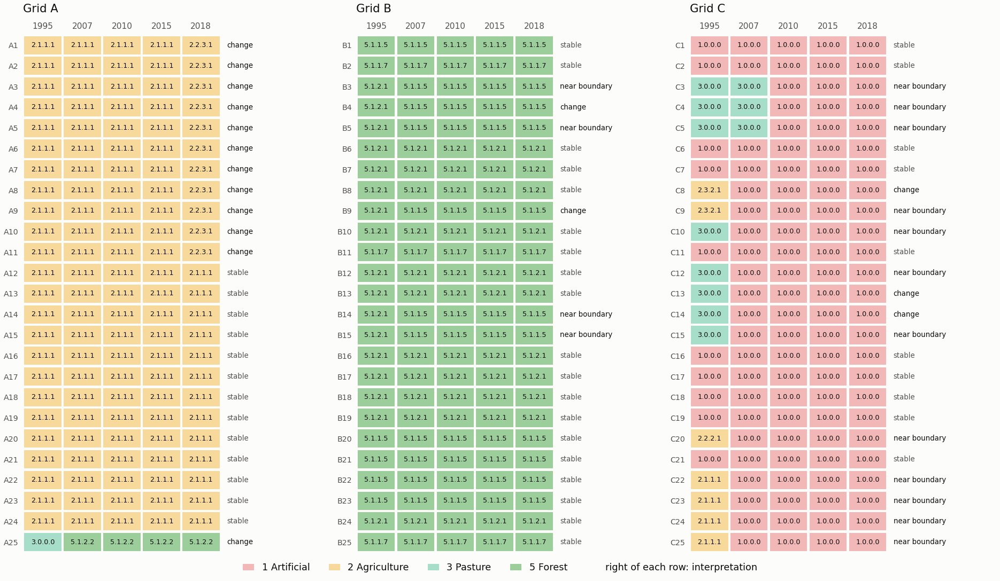

# dgt-cos-trajectories

Land-use/land-cover (LULC) history of point samples from the *Carta de Uso e Ocupação do Solo*
(COS) of mainland Portugal, published by the Direção-Geral do Território (DGT).

For each sample point the tool extracts the COS class in every edition of a COS series and derives
the class trajectory, temporal-stability metrics and positional-uncertainty flags. It is available
as an ArcGIS Pro toolbox and as a Python command-line program. The output contains only the sample
identifier and COS-derived variables, for joining to external tables by identifier.



*Figure 1. Demonstration grid C (synthetic points, 100 m spacing) over COS1995 and COS2018
(Series 1, both expressed in the COS1995 nomenclature). Filled markers: the class at the point
changed between 1995 and 2018. Rings: points closer than 25 m to a polygon boundary in at least one
edition.*

## Contents

1. [Data](#1-data)
2. [Method](#2-method)
3. [Metrics](#3-metrics)
4. [Usage](#4-usage)
5. [Outputs and field reference](#5-outputs-and-field-reference)
6. [Worked example](#6-worked-example)
7. [Limitations](#7-limitations)
8. [Software reference](#8-software-reference)
9. [References, citation and licence](#9-references-citation-and-licence)

## 1. Data

COS is a vector map of homogeneous LULC units with a four-level hierarchical nomenclature. Class
codes are dotted (`5.1.2.1`); each level is a prefix of the next (`5` Florestas ⊃ `5.1` ⊃ `5.1.2`
Florestas de resinosas ⊃ `5.1.2.1` Florestas de pinheiro bravo). DGT publishes two series:

| Series | Editions | Nomenclature (level 4) | Minimum mapping unit |
|---|---|---|---|
| S1 | COS1995v2 | 44 classes (simplified) | 1 ha |
| S1 | COS2007v3, COS2010v2, COS2015v2, COS2018v2 | 83 classes | 1 ha |
| S2 | COS2018v4, COS2025v1 | 102 classes | 0.5 ha |
| S2 (earlier specification) | COS2018v3, COS2023v1 | 93 classes | 1 ha |

All editions: minimum distance between lines 20 m, ETRS89/PT-TM06 (EPSG:3763), thematic accuracy
≥ 85 %, positional accuracy ≤ 5.5 m (DGT 2022, 2026).

Comparability, as stated by DGT (2026): editions within Series 1 are mutually consistent; within
Series 2 only COS2018v4 and COS2025v1 are comparable with each other; maps of different series
should not be compared, because Series 2 changed the base concepts of the classification, the
structure of the nomenclature and the geometric detail.

The COS data are not distributed with this repository. They are downloaded from DGT (see
[00_ZIP/README.md](00_ZIP/README.md)) and unzipped into [01_COS/](01_COS/README.md).

## 2. Method

### 2.1 Identification of the COS layers

Files in the COS folder are identified by the DGT file-name convention
`COS<year>v<version>[-S<series>]` (case-insensitive). The pair (year, version) is looked up in
[`cos_trajectories/catalog.json`](cos_trajectories/catalog.json), which gives the series, layer
name, class field, polygon identifier field and nomenclature. The presence of the class and
identifier fields in the file is then verified; a mismatch stops the run. Files that do not follow
the convention (for example COS conjuntural, `COSc2020`) and editions not in the catalog are
ignored and listed in the manifest. Two versions of the same edition in one series stop the run.

### 2.2 Selection of comparable editions

- One series per analysis (`S1` or `S2`), or both side by side without merging (`S1+S2`, section 2.6).
- Editions flagged obsolete in the catalog are excluded. This applies to COS2023v1, which uses the
  earlier 93-class Series 2 specification: several level-4 codes denote different classes (code
  `1.2.2.1` is *Instalações agrícolas e pecuárias* in COS2023v1 and *Áreas edificadas turísticas*
  in COS2025v1).
- At least two editions are required.

### 2.3 Harmonisation of nomenclatures within Series 1

COS1995 is not a hierarchical prefix of the later editions: it has a single class `1.0.0.0` for
all artificial surfaces, `3.0.0.0` for all pastures and `7.1.1.0` for beaches, dunes and sands.
Comparing raw codes would produce spurious changes at levels 2–4 (1995 `3.0` versus 2007 `3.1`).

When COS1995 is among the selected editions, the level-4 codes of 2007–2018 are recoded to the
44 COS1995 classes with the correspondence table of DGT (2022, Anexo 3):

| COS2007–2018 code | COS1995 code |
|---|---|
| `1.x.x.x` (33 classes) | `1.0.0.0` |
| `2.3.1.1`, `2.3.1.2`, `2.3.1.3` (crops/pasture under vineyard, orchard, olive) | `2.2.1.1`, `2.2.2.1`, `2.2.3.1` |
| `2.4.1.1` (protected agriculture) | `2.1.1.1` |
| `3.1.1.1`, `3.1.2.1` | `3.0.0.0` |
| `5.1.1.6` (invasive species) | `5.1.1.7` |
| `7.1.1.1`, `7.1.1.2` | `7.1.1.0` |
| all other codes | unchanged |

Without COS1995 in the folder, the 83-class nomenclature is used unchanged. The full table is
written to the data dictionary of each run.

### 2.4 Comparison level

Let $h(c)$ be the harmonised level-4 code of a polygon. The class at comparison level
$L \in \lbrace 1,2,3,4\rbrace $ is the truncation of the dotted code to its first $L$ elements,
$c^{(L)} = \mathrm{trunc}_L(h(c))$, for example $\mathrm{trunc}_2(\texttt{2.3.1.1}) = \texttt{2.3}$.
The default is the most detailed level common to all selected editions ($L = 4$ for the catalogued
editions). The level-4 field is always the one read, because some editions store levels 1–3
without dots (`111`).

### 2.5 Spatial assignment

1. Samples are reprojected to the CRS of the COS layers (EPSG:3763). A projected COS CRS, identical
   for all editions, is required.
2. For each edition, only polygons whose envelope intersects the bounding box of all samples plus
   100 m are read.
3. Each point $p$ is assigned the polygon $P$ with $p \in P$ (predicate *intersects*). A point
   lying exactly on a shared edge intersects more than one polygon; the polygon with the lowest DGT
   `ID` is kept and the number of such points per edition is reported. A point outside every
   polygon has a missing class in that edition.
4. The distance to the polygon boundary, including interior rings, is

$$d_t(p) = \min_{q \in \partial P_t} \lVert p - q \rVert .$$

### 2.6 Series 1 and Series 2 side by side (`S1+S2`)

DGT (2026, Anexo 3) lists the main differences between the Series 1 nomenclature and that of
COS2018v4/COS2025v1 (renamed classes, redefined classes, new thematic detail, classes without
counterpart) and advises against comparative analyses across series. Both series contain a map of
2018, which allows the discontinuity to be measured for a single reference year. Rasterising
COS2018v2 (S1) and COS2018v4 (S2) at 50 m over mainland Portugal, excluding water, the two maps
assign the same level-1 class to 81.5 % of the land area and the same level-4 code to 53.0 %.
Grouping the level-4 classes that Anexo 3 relates to each other gives 74.7 % agreement on the
96.5 % of the area whose Series 1 class has a Series 2 counterpart. These differences arise from
definitions, production method and mapping unit, not from land-use change.

A single 1995–2025 trajectory is therefore not computed. With `S1+S2`:

- each series is processed independently, exactly as in a single-series run;
- the results are written in one table, with every variable suffixed `_S1` or `_S2`;
- no change, trajectory or metric is computed across the two series;
- for each reference year $y$ present in both series (2018), an agreement flag is added:

$$a_y = \mathbb{1}\left[\mathrm{trunc}_1\left(c_y^{S1}\right) = \mathrm{trunc}_1\left(c_y^{S2}\right)\right].$$

The two nomenclatures share the nine level-1 classes (same codes and names). The flag is a
consistency check defined by this tool on those codes; it is not a DGT correspondence between
series, and $a_y = 0$ denotes a difference between the two maps of the same year, not a change.

## 3. Metrics

Notation. Editions $t = 1,\dots,T$ with reference years $y_1 < \dots < y_T$; $c_t$ is the class of
the sample at edition $t$ at the comparison level, or missing if the point lies outside every
polygon. The observed editions are $O = \lbrace t : c_t \text{ not missing}\rbrace $, re-indexed
$k = 1,\dots,m$ in time order, with classes $c_{(k)}$ and years $y_{(k)}$. Metrics are computed on
the observed editions only; with $m < 2$ all change-based metrics are missing. In `S1+S2` runs the
metrics are computed separately for each series.

| Variable | Definition | Range |
|---|---|---|
| `trajectory` | $c_1 \mid c_2 \mid \dots \mid c_T$, with `NA` for a missing class | text |
| `n_missing` | $T - m$ | $0..T$ |
| `n_changes` | $N = \sum_{k=2}^{m} \mathbb{1}\left[c_{(k)} \neq c_{(k-1)}\right]$ | $0..m-1$ |
| `stable` | $S = \mathbb{1}[N = 0]$ | 0/1 |
| `stability_index` | $SI = 1 - \dfrac{N}{m-1}$ | $[0,1]$ |
| `modal_persistence` | $P = \max_{j} \dfrac{1}{m} \sum_{k=1}^{m} \mathbb{1}\left[c_{(k)} = j\right]$ | $[1/m,1]$ |
| `time_weighted_persistence` | $P_w = \dfrac{\sum_{k=2}^{m} \left(y_{(k)} - y_{(k-1)}\right) \mathbb{1}\left[c_{(k)} = c_{(k-1)}\right]}{y_{(m)} - y_{(1)}}$ | $[0,1]$ |
| `last_change_year` | $\max \lbrace  y_{(k)} : c_{(k)} \neq c_{(k-1)} \rbrace $; missing if $N = 0$ | year |
| `flip_flop` | $F = \mathbb{1}\left[\exists k : c_{(k)} \neq c_{(k+1)} \wedge c_{(k+2)} = c_{(k)}\right]$ | 0/1 |
| `min_boundary_dist_m` | $d_{\min} = \min_{t \in O} d_t$ | m |
| `near_boundary` | $B = \mathbb{1}[d_{\min} < \tau]$, with $\tau$ the boundary threshold (default 25 m) | 0/1 |
| `pts_in_poly_<y_T>` | number of samples assigned to the same polygon as the sample in the last edition | $\geq 1$ |

Interpretation:

- $SI$ weights every interval equally; $P_w$ weights each interval by its duration. The Series 1
  intervals are 12, 3, 5 and 3 years, so a single change in 1995–2007 gives $SI = 0.75$ and
  $P_w = 11/23 = 0.478$, whereas a single change in 2015–2018 gives $SI = 0.75$ and
  $P_w = 20/23 = 0.870$.
- $P$ measures dominance of one class irrespective of order.
- $F = 1$ (A → B → A) between close editions is frequently a photo-interpretation artefact.
- $B = 1$ marks samples for which a class change may result from differences in polygon delineation
  between editions. The default $\tau = 25$ m is of the order of the minimum distance between lines
  (20 m) plus the positional accuracy (5.5 m).
- `pts_in_poly` quantifies pseudo-replication: samples in the same polygon share the same class by
  construction.

No composite index is computed; each metric answers a different question.

Transition matrix between consecutive editions $t-1$ and $t$ (point counts, with `NA` as an
additional category):

$$M_{ij} = \left|\lbrace  p : c_{t-1}(p) = i \wedge c_t(p) = j \rbrace \right|, \qquad \sum_{i,j} M_{ij} = n .$$

Group summary, for a group $g$ of $n_g$ samples (optional group field):

| Variable | Definition |
|---|---|
| `n_points` | $n_g$ |
| `n_polygons_<year>` | number of distinct polygons containing the samples of the group |
| `prop_changed` | $\dfrac{\lvert\lbrace p \in g : N_p > 0\rbrace \rvert}{\lvert\lbrace p \in g : m_p \geq 2\rbrace \rvert}$ |
| `n_trajectories` | number of distinct trajectories |
| `prop_near_boundary` | mean of $B$ over the group |
| `prop_agree_l1_<year>` | mean of $a_y$ over the group (`S1+S2` only) |

## 4. Usage

### 4.1 Requirements

Python 3.13 with geopandas, shapely, fiona, pandas, numpy and pyproj, in the versions shipped with
the default ArcGIS Pro environment `arcgispro-py3` ([requirements.txt](requirements.txt),
[environment.yml](environment.yml)). No additional package is needed and no environment has to be
cloned. Outside ArcGIS, `conda env create -f environment.yml` gives an equivalent environment.

### 4.2 Data preparation

1. Unzip the COS GeoPackages into `01_COS/` without renaming them.
2. Provide the samples as a point layer (shapefile or GeoPackage) with a unique identifier field,
   in any coordinate reference system.

### 4.3 ArcGIS Pro

*Catalog → Toolboxes → Add Toolbox* → `COSTrajectories.pyt` → **COS land-use history of sample
points**. The toolbox runs the analysis in a separate Python process of the active ArcGIS Pro
environment and reports its messages in the geoprocessing pane; the result layer is added to the
active map.

### 4.4 Command line

```shell
python -m cos_trajectories --series S1 --samples 02_Amostras/samples.shp --id-field SAMPLE_ID
python -m cos_trajectories --series S1+S2 --samples examples/demo_points.gpkg \
    --samples-layer demo_points --id-field SAMPLE_ID --group-field GRID --run-id demo
```

With ArcGIS Pro installed, `python` is
`"C:\Program Files\ArcGIS\Pro\bin\Python\envs\arcgispro-py3\python.exe"`.

### 4.5 Parameters

| Toolbox parameter | CLI option | Default | Description |
|---|---|---|---|
| COS folder | `--cos-dir` | `01_COS` | Folder with the unzipped COS GeoPackages. |
| COS series | `--series` | required | `S1`, `S2` or `S1+S2` (side by side, section 2.6). |
| Sample points | `--samples`, `--samples-layer` | required | Point layer; shapefile or GeoPackage layer. |
| Sample ID field | `--id-field` | required | Unique, non-empty identifier. |
| Group field | `--group-field` | none | Adds `group_summary.csv`. |
| Comparison level | `--level` | most detailed common level | $L$, 1 to 4 (section 2.4). |
| Boundary threshold | `--threshold` | 25 | $\tau$ in metres (section 3). |
| Output folder | `--out-dir` | `03_Resultados` | A subfolder is created per run; existing runs are never overwritten. |
| (none) | `--run-id` | start time `YYYYMMDD-HHMMSS` | Name of the run subfolder. |
| (none) | `--no-hash` | off | Skip the SHA-256 checksums of the COS files. |

Invalid input (non-point geometry, duplicated or empty identifiers, missing CRS, level above the
common level, fewer than two editions) stops the run with an explicit message; exit code 2.

## 5. Outputs and field reference

Each run writes to `<output folder>/<run id>/`:

| File | Content |
|---|---|
| `samples_cos_history.csv` | One row per sample (UTF-8 with BOM), sorted by identifier in natural order (`A2` before `A10`). |
| `samples_cos_history.gpkg` | Same table with point geometry, EPSG:3763, layer `samples_cos_history`. |
| `transitions_<a>_<b>.csv` | Transition matrix $M$ between consecutive editions `a` and `b` (`transitions_<series>_<a>_<b>.csv` in `S1+S2` runs). |
| `bridge_<year>_level1.csv` | `S1+S2` only: level-1 class in S1 (rows) against S2 (columns) for a year present in both series. |
| `group_summary.csv` | One row per group, if a group field is given. |
| `manifest.json` | Provenance (below). |
| `data_dictionary.md` | Description of every column, class tables, correspondence table, limitations and run summary. |
| `run.log` | Processing messages and warnings. |

### 5.1 `samples_cos_history`

`<year>` stands for each edition year of the series. In `S1+S2` runs every field below except the
identifier and `agree_l1_<year>` exists once per series, with suffix `_S1` or `_S2`
(`cls_2018_S1`, `trajectory_S2`).

| Field | Type | Description |
|---|---|---|
| *identifier* | text | Sample identifier; the field keeps the name it has in the input layer. |
| `cls_<year>` | text | Class code $c_t$ at the comparison level, after harmonisation. Empty if no polygon contains the point. |
| `label_<year>` | text | DGT class designation (Portuguese) of `cls_<year>`. |
| `poly_<year>` | text | Polygon identifier `<year>_<ID>`, with `ID` the DGT polygon identifier of that edition. Not comparable between editions. |
| `dist_<year>` | float, m | $d_t$, distance to the boundary of the containing polygon (2 decimals). |
| `trajectory` | text | Classes in time order separated by <code>&#124;</code>. |
| `n_missing` | integer | Editions without a containing polygon. |
| `stable` | 0/1 | $S$. |
| `n_changes` | integer | $N$. |
| `stability_index` | float | $SI$ (4 decimals). |
| `modal_persistence` | float | $P$ (4 decimals). |
| `time_weighted_persistence` | float | $P_w$ (4 decimals). |
| `last_change_year` | integer | Year of the edition in which the last change is observed; empty if stable. |
| `flip_flop` | 0/1 | $F$. |
| `min_boundary_dist_m` | float, m | $d_{\min}$. |
| `near_boundary` | 0/1 | $B$. |
| `pts_in_poly_<last year>` | integer | Samples sharing the polygon of the last edition. |
| `agree_l1_<year>` | 0/1 | `S1+S2` only: $a_y$ (section 2.6); empty if either class is missing. |

### 5.2 `manifest.json`

| Key | Content |
|---|---|
| `run_id`, `started`, `tool_version` | Run identification. |
| `parameters` | All parameter values, with absolute paths. |
| `series[]` | Per series: `nomenclature`, `crosswalks_applied`, `max_common_level`, `cos_layers[]` (edition, version, layer, class field, path, size, modification time, SHA-256) and `excluded_cos_layers[]` with the reason. |
| `ignored_files[]` | Files of the COS folder that were not used, with the reason. |
| `samples` | Path, layer, CRS and number of features of the sample layer. |
| `counts` | Samples in and out; per series: samples on shared edges and outside coverage per edition, stable, near boundary, flip-flop; `bridge` agreement counts. |
| `software` | Versions of Python, geopandas, shapely, fiona, GDAL, pandas, numpy, pyproj. |
| `outputs[]` | Files written. |

Outputs are deterministic for given inputs (sorted rows and columns), apart from the run
identifier and timestamps.

## 6. Worked example

[`examples/demo_points.gpkg`](examples/demo_points.gpkg) contains 75 synthetic points: three
5 × 5 grids with 100 m spacing at arbitrary locations (generated by
[`tools/make_demo_points.py`](tools/make_demo_points.py)). They are not sampling locations of any
study. The second command of section 4.4 produces:

```text
INFO cos_trajectories 0.1.0, run demo
INFO series S1, editions [1995, 2007, 2010, 2015, 2018], nomenclature S1-1995
INFO recoding S1-2007 to S1-1995 with the DGT crosswalk
WARNING excluded COS2023v1-S2: COS2023v1 follows the earlier Series 2 specifications (...)
INFO series S2, editions [2018, 2025], nomenclature S2-2025
INFO series linked side by side, not merged: no change is computed across the series
INFO comparison level 4
INFO 75 samples read from demo_points.gpkg
(...)
INFO 2018: same level-1 class in S1 and S2 at 68 of 75 samples (a difference here is a change of
     nomenclature or delineation, not of land use)
INFO computing SHA-256 of 7 COS files for the manifest
INFO done: 75 samples written to 03_Resultados\demo
```



*Figure 2. Class code of the 75 demonstration samples in each edition (colour: level-1 class).
Series 1 and Series 2 are shown side by side and are not connected. Grid A: annual crops converted
to olive groves. Grid B: maritime pine replaced by eucalyptus between 1995 and 2007. Grid C: urban
expansion over pasture and cropland.*

Three rows of `samples_cos_history.csv` (Series 1 fields; `label_`, `poly_` and `dist_` omitted):

| SAMPLE_ID | `trajectory_S1` | `n_changes_S1` | `stability_index_S1` | `modal_persistence_S1` | `time_weighted_persistence_S1` | `last_change_year_S1` | `min_boundary_dist_m_S1` | `near_boundary_S1` | `agree_l1_2018` |
|---|---|---|---|---|---|---|---|---|---|
| A1 | <code>2.1.1.1&#124;2.1.1.1&#124;2.1.1.1&#124;2.1.1.1&#124;2.2.3.1</code> | 1 | 0.75 | 0.8 | 0.8696 | 2018 | 157.12 | 0 | 1 |
| C3 | <code>3.0.0.0&#124;3.0.0.0&#124;1.0.0.0&#124;1.0.0.0&#124;1.0.0.0</code> | 1 | 0.75 | 0.6 | 0.8696 | 2010 | 2.19 | 1 | 0 |
| C12 | <code>3.0.0.0&#124;1.0.0.0&#124;1.0.0.0&#124;1.0.0.0&#124;1.0.0.0</code> | 1 | 0.75 | 0.8 | 0.4783 | 2007 | 6.83 | 1 | 1 |

The three samples have the same $SI$ and different $P_w$: 20/23 for the changes in 2015–2018 (A1)
and 2007–2010 (C3), 11/23 for the change in 1995–2007 (C12). C3 and C12 lie within 25 m of a
boundary, so their changes may reflect delineation. At C3 the two maps of 2018 disagree
(artificial in Series 1, shrubland in Series 2).

`group_summary.csv` (selected columns):

| GRID | `n_points` | `n_polygons_2018_S1` | `prop_changed_S1` | `n_trajectories_S1` | `prop_near_boundary_S1` | `prop_changed_S2` | `prop_agree_l1_2018` |
|---|---|---|---|---|---|---|---|
| A | 25 | 3 | 0.48 | 3 | 0.04 | 0.52 | 1.00 |
| B | 25 | 8 | 0.24 | 4 | 0.48 | 0.08 | 1.00 |
| C | 25 | 12 | 0.60 | 6 | 0.72 | 0.24 | 0.72 |

In grid A the 25 points fall in 3 polygons in 2018: the 12 changed points are not 12 independent
observations of change.

`bridge_2018_level1.csv` (rows: Series 1; columns: Series 2):

| 2018_S1 \ 2018_S2 | 1 | 2 | 5 | 6 |
|---|---|---|---|---|
| 1 | 18 | 0 | 0 | 7 |
| 2 | 0 | 24 | 0 | 0 |
| 5 | 0 | 0 | 26 | 0 |

The figures are reproduced with `python tools/make_readme_figures.py 03_Resultados/demo 01_COS`.

## 7. Limitations

- **Mapping unit.** Features smaller than the minimum mapping unit (1 ha; 0.5 ha in
  COS2018v4/COS2025v1) or narrower than 20 m are generalised into neighbouring classes. The class
  at a point is that of the mapped unit, not necessarily of the ground at the point.
- **Temporal coverage.** Nothing before 1995 (S1) or 2018 (S2) is represented. Changes between
  editions are located only to the interval between reference years; changes reverted within an
  interval are not observed.
- **Delineation.** Differences in polygon delineation between editions produce apparent changes
  near boundaries (`near_boundary`). The positional uncertainty of the sample coordinates adds to
  this effect and is not modelled.
- **Interpretation artefacts.** A → B → A sequences between close editions (`flip_flop`).
- **Thematic accuracy.** The COS specification is ≥ 85 %; classification errors propagate to the
  trajectories and are not modelled.
- **Spatial dependence.** Clustered samples share polygons (`pts_in_poly`) and are not independent
  observations. Transition matrices are counts of samples, not area estimates.
- **Series.** Series 1 and Series 2 are not comparable (section 2.6); `agree_l1_<year>` compares
  level-1 codes only.
- **Harmonisation.** Recoding Series 1 to the COS1995 nomenclature removes the thematic detail of
  2007–2018 for artificial surfaces and pastures (section 2.3).
- **Geometry.** Only point samples are supported. Samples spread over a large extent require most
  of each national layer to be read (section 2.5).

## 8. Software reference

```text
cos_trajectories/        core package (no arcpy)
  catalog.json           known COS products, nomenclatures and correspondence tables
  nomenclature/*.csv     class code -> designation, per nomenclature and level
  catalog.py  io.py  core.py  metrics.py  report.py  cli.py
COSTrajectories.pyt      ArcGIS Pro toolbox (arcpy only here; runs the CLI in a subprocess)
tools/                   maintainer scripts (nomenclature extraction, demonstration data, figures)
tests/                   pytest suite on synthetic GeoPackages
```

| Module | Function | Purpose |
|---|---|---|
| `catalog` | `discover(cos_dir)` | Identify COS layers by file name, check layer and fields; returns sources and ignored files. |
| | `select(found, series)` | Editions of a series to compare, common nomenclature, correspondence tables, maximum common level, excluded editions. |
| | `Selection.harmonise(code, source)` | $h(c)$: level-4 code in the common nomenclature. |
| | `recode(code, level)` | $\mathrm{trunc}_L$. |
| | `load_labels(nomenclature)` | `{(level, code): designation}`. |
| `io` | `list_layers`, `layer_info`, `read_layer` | Vector reading through fiona (pyogrio used for metadata if available); `read_layer` accepts `bbox` and `columns`. |
| | `write_gpkg`, `write_csv`, `write_json`, `write_text` | Output writers. |
| | `file_fingerprint(path)` | Size, modification time, SHA-256. |
| `core` | `prepare_samples(gdf, id_field, group_field)` | Validation of the sample layer (points, CRS, unique non-empty identifiers). |
| | `join_edition(samples, cos, code_field, id_field, year)` | Point-in-polygon assignment, shared-edge rule, $d_t$. |
| | `run(...)` | Full pipeline; writes all outputs and returns the history table. |
| `metrics` | `sample_metrics(classes, years)` | Metrics of section 3 for one sample. |
| | `compute_metrics(history, years, boundary_threshold_m)` | Metrics for all samples, $B$ and `pts_in_poly`. |
| | `transition_matrix(a, b)` | $M$. |
| | `group_summary(history, group_field, years)` | Group table. |
| | `natural_key(value)` | Natural sort key for identifiers. |
| `report` | `build_manifest(...)`, `data_dictionary(...)` | `manifest.json` and `data_dictionary.md`. |
| `cli` | `main(argv)` | Command-line entry point (`python -m cos_trajectories`). |

Tests: `python -m pytest` (synthetic data only; runs without ArcGIS).

Adding a COS edition: add the product to `catalog.json` (with a new nomenclature and correspondence
table if the classes change), unzip it into `01_COS/`, run
`python tools/extract_nomenclature.py 01_COS`, then the tests.

## 9. References, citation and licence

- Direção-Geral do Território (2022). *Especificações técnicas da Carta de Uso e Ocupação do Solo
  (COS) de Portugal Continental para 1995, 2007, 2010, 2015 e 2018*. Relatório Técnico.
  <https://www.dgterritorio.gov.pt/sites/default/files/documentos-publicos/ET-COS-1995-2007-2010-2015-2018-v1.pdf>
- Direção-Geral do Território (2026). *Especificações técnicas da Série 2 da Carta de Uso e
  Ocupação do Solo (COS) de Portugal Continental*. Relatório Técnico.
- Direção-Geral do Território. *Carta de Uso e Ocupação do Solo (COS) – Série 2 – (2018v4 – 2025v1)*.
  <https://dados.gov.pt/pt/datasets/carta-de-uso-e-ocupacao-do-solo-cos-serie-2-2018v4-2025v1>

COS data © Direção-Geral do Território. The figures of this document are derived from COS1995v2,
COS2018v2, COS2018v4 and COS2025v1.

Citation: see [CITATION.cff](CITATION.cff). Licence: [Apache License 2.0](LICENSE).
