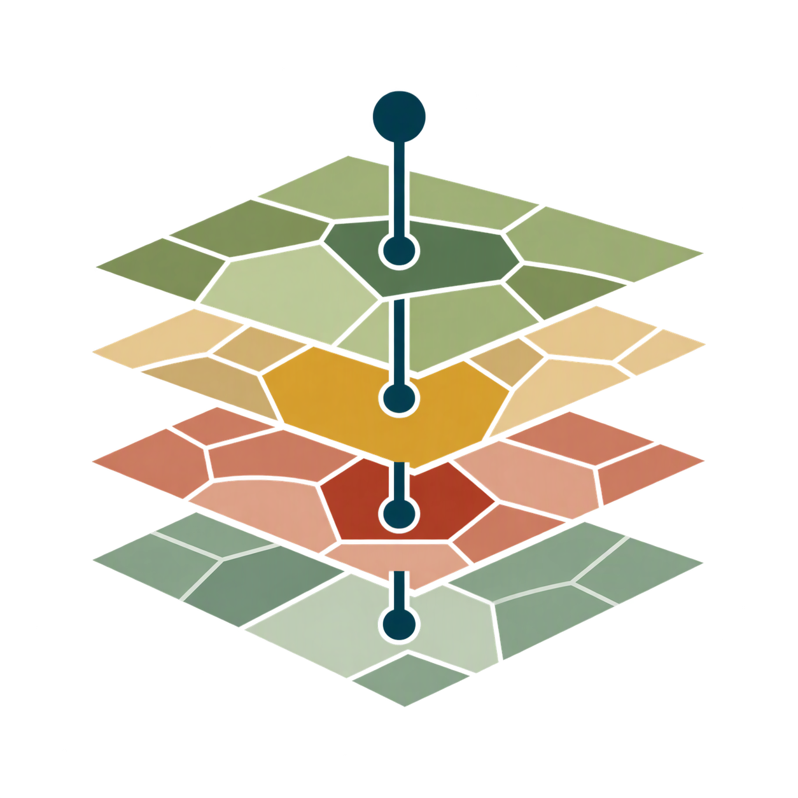

<p align="center"></p>

<p align="center">
  <a href="https://doi.org/10.5281/zenodo.24188122"></a>
  <a href="https://github.com/PedroMMGoncalves/dgt-cos-trajectories/releases/latest"></a>
  <a href="LICENSE"></a>
  
  
  
</p>

# dgt-cos-trajectories

Land-use/land-cover history of point samples from the *Carta de Uso e Ocupação do Solo* (COS) of
mainland Portugal, published by the Direção-Geral do Território (DGT).

Given a layer of sample points, the tool reads the COS class at each point in every edition and
returns one row per sample with the class history, stability metrics and an interpretation
category. It runs as an ArcGIS Pro toolbox or from the command line.

| Document | Content |
|---|---|
| This page | What the tool does, how to run it, what it writes |
| [docs/METHODS.md](docs/METHODS.md) | Mathematical definition of every calculation |
| [docs/INTERPRETATION.md](docs/INTERPRETATION.md) | How to read and use the results |


*Figure 1. Demonstration grid C (synthetic points, 100 m spacing) over COS1995 and COS2018
(Series 1, COS1995 nomenclature). Marker fill: interpretation category of each sample.*

## 1. Two products

| `--series` | Editions | Period | Classes | Purpose |
|---|---|---|---|---|
| `S1` | COS1995v2, COS2007v3, COS2010v2, COS2015v2, COS2018v2 | 1995–2018 | COS1995 nomenclature (44 classes) | Long history |
| `S2` | COS2018v4, COS2025v1 | 2018–2025 | Series 2 nomenclature (102 classes) | Recent change at the highest thematic and geometric detail |

Notes:

- **`S1`.** COS1995 has fewer classes than the later editions. The 2007–2018 classes are recoded to
  the COS1995 classes with the DGT correspondence table (DGT 2022, Anexo 3), so that a code means
  the same in all five editions. Without COS1995 in the folder, the 83-class nomenclature is used.
- **`S2`.** COS2023v1 is excluded: it follows an earlier Series 2 specification in which several
  codes denote other classes, and DGT states that only COS2018v4 and COS2025v1 are comparable.
- **The series are not combined.** DGT (2026) states that maps of different series should not be
  compared, because Series 2 changed the base concepts of the classification, the structure of the
  nomenclature and the geometric detail. To cover 1995–2025, run both modes and join the two tables
  by sample identifier, reading them as two separate histories
  ([INTERPRETATION 3](docs/INTERPRETATION.md#3-choosing-the-series)).

## 2. Running

### Requirements

The default ArcGIS Pro Python environment (`arcgispro-py3`: Python 3.13, geopandas, shapely, fiona,
pandas, numpy, pyproj, openpyxl) with no additional package. Outside ArcGIS,
`conda env create -f environment.yml` gives an equivalent environment.

### Data

1. Download the COS GeoPackages from DGT ([00_ZIP/README.md](00_ZIP/README.md)) and unzip them into
   `01_COS/` without renaming. Editions are identified by the DGT file name
   (`COS<year>v<version>[-S<series>]`) through [`cos_trajectories/catalog.json`](cos_trajectories/catalog.json).
2. Provide the samples as a point layer (shapefile or GeoPackage) with a unique identifier field,
   in any coordinate reference system.

### ArcGIS Pro

*Catalog → Toolboxes → Add Toolbox* → `COSTrajectories.pyt` → **COS land-use history of sample
points**. The analysis runs in a separate Python process of the active environment; messages
appear in the geoprocessing pane and the result layer is added to the map.

### Command line

```shell
python -m cos_trajectories --series S1 --samples 02_Amostras/samples.shp --id-field SAMPLE_ID
python -m cos_trajectories --series S1 --samples examples/demo_points.gpkg \
    --samples-layer demo_points --id-field SAMPLE_ID --group-field GRID --run-id demo
```

With ArcGIS Pro installed, `python` is
`"C:\Program Files\ArcGIS\Pro\bin\Python\envs\arcgispro-py3\python.exe"`.

### Parameters

| Toolbox parameter | CLI option | Default | Description |
|---|---|---|---|
| COS folder | `--cos-dir` | `01_COS` | Folder with the unzipped COS GeoPackages. |
| COS series | `--series` | required | `S1` or `S2`. |
| Sample points | `--samples`, `--samples-layer` | required | Point layer; shapefile or GeoPackage layer. |
| Sample ID field | `--id-field` | required | Unique, non-empty identifier. |
| Group field | `--group-field` | none | Adds `group_summary.csv`. |
| Comparison level | `--level` | most detailed | 1 to 4; level at which the metrics and the interpretation are computed. The classes and the number of changes are written for all four levels in every run. |
| Boundary threshold | `--threshold` | 25 | Metres; sets `near_boundary`. |
| Output folder | `--out-dir` | `03_Resultados` | One subfolder per run; never overwritten. |
| (none) | `--run-id` | start time | Name of the run subfolder. |
| (none) | `--no-hash` | off | Skip the SHA-256 checksums of the COS files. |

Invalid input (non-point geometry, duplicated or empty identifiers, missing CRS, unavailable
level, fewer than two editions) stops the run with a message; exit code 2.

## 3. Outputs

Written to `<output folder>/<run id>/`. `<samples>` is the name of the sample layer, `<series>`
is `S1` or `S2` and `<level>` the comparison level, for example `plots_COS_S1_L4.shp`:

| File | Content |
|---|---|
| `<samples>_COS_<series>_L<level>.xlsx` | One row per sample (Excel). |
| `<samples>_COS_<series>_L<level>.csv` | Same table as text (UTF-8). |
| `<samples>_COS_<series>_L<level>.gpkg` | Same table with point geometry (EPSG:3763); full field names. |
| `<samples>_COS_<series>_L<level>.shp` | Same table as a shapefile; field names shortened to 10 characters (listed in `data_dictionary.md`). |
| `interpretation_summary.csv` | Number and share of samples per interpretation category. |
| `transitions_<a>_<b>.csv` | Samples per class in edition `a` (rows) and edition `b` (columns), consecutive editions. |
| `group_summary.csv` | One row per group, if a group field is given. |
| `data_dictionary.md` | Columns, classes, correspondence tables and limitations of the run. |
| `manifest.json` | Parameters, input files with SHA-256, software versions, counts. |
| `run.log` | Processing messages. |

### Fields of `<samples>_COS_<series>_L<level>`

`<year>` is each edition year of the trajectory. Formulas: [docs/METHODS.md](docs/METHODS.md).

| Field | Description | METHODS |
|---|---|---|
| *identifier* | Sample identifier, with the name it has in the input layer. | |
| `cls_<year>` | Class code at the comparison level. Empty if no polygon contains the point. | 2, 3.3 |
| `label_<year>` | DGT class designation. | |
| `cls_<year>_L<k>` | Class code at every level k = 1 to 4, whatever the comparison level. | 2.1 |
| `poly_<year>` | Polygon identifier `<year>_<DGT ID>`. | 3.3 |
| `dist_<year>` | Distance from the point to the polygon boundary (m). | 3.4 |
| `trajectory` | Classes in time order separated by <code>&#124;</code>; `NA` if missing. | 4.1 |
| `n_missing` | Editions without a polygon at the point. | 4.1 |
| `stable` | 1 if the class never changes. | 4.2 |
| `n_changes` | Number of changes between consecutive editions. | 4.3 |
| `stability_index` | Share of intervals without change. | 4.3 |
| `modal_persistence` | Share of editions in the most frequent class. | 4.4 |
| `time_weighted_persistence` | Share of the years without change. | 4.5 |
| `last_change_year` | Year of the edition in which the last change is observed. | 4.6 |
| `flip_flop` | 1 if the class goes A → B → A in consecutive editions. | 4.7 |
| `min_boundary_dist_m` | Smallest `dist_<year>`. | 4.8 |
| `near_boundary` | 1 if `min_boundary_dist_m` is below the threshold. | 4.8 |
| `pts_in_poly_<last year>` | Samples sharing the polygon of the last edition. | 4.9 |
| `n_changes_L<k>` | Number of changes when classes are compared at level k = 1 to 4. | 4.3 |
| `interpretation` | `stable`, `change`, `near_boundary`, `flip_flop` or `insufficient_data`. | 5 |

### `interpretation`

| Category | Meaning |
|---|---|
| `stable` | Same class in every edition. |
| `change` | Class changed; no artefact indicator applies. |
| `near_boundary` | Class changed, but the point is near a polygon boundary: possibly a difference in delineation. |
| `flip_flop` | Class changed and returned: probable interpretation artefact. |
| `insufficient_data` | Fewer than two editions with a class. |

Use and caveats of each category: [docs/INTERPRETATION.md](docs/INTERPRETATION.md).

## 4. Example

[`examples/demo_points.gpkg`](examples/demo_points.gpkg) holds 75 synthetic points: three 5 × 5
grids with 100 m spacing at arbitrary locations. They are not sampling locations of any study. The
second command of section 2 gives:

`interpretation_summary.csv`:

| interpretation | n_samples | share |
|---|---|---|
| stable | 42 | 0.560 |
| change | 17 | 0.227 |
| near_boundary | 16 | 0.213 |
| flip_flop | 0 | 0.000 |
| insufficient_data | 0 | 0.000 |


*Figure 2. Class of the 75 demonstration samples in each Series 1 edition (colour: level-1 class)
and their interpretation category. Grid A: annual crops (`2.1.1.1`) converted to olive groves
(`2.2.3.1`). Grid B: maritime pine (`5.1.2.1`) replaced by eucalyptus (`5.1.1.5`). Grid C: urban
expansion (`1.0.0.0`) over pasture and cropland.*

Selected rows of `<samples>_COS_<series>_L<level>.csv`:

| SAMPLE_ID | `trajectory` | `n_changes` | `stability_index` | `time_weighted_persistence` | `last_change_year` | `min_boundary_dist_m` | `interpretation` |
|---|---|---|---|---|---|---|---|
| B7 | <code>5.1.2.1&#124;5.1.2.1&#124;5.1.2.1&#124;5.1.2.1&#124;5.1.2.1</code> | 0 | 1.0 | 1.0 | | 52.57 | stable |
| A1 | <code>2.1.1.1&#124;2.1.1.1&#124;2.1.1.1&#124;2.1.1.1&#124;2.2.3.1</code> | 1 | 0.75 | 0.8696 | 2018 | 157.12 | change |
| B4 | <code>5.1.2.1&#124;5.1.1.5&#124;5.1.1.5&#124;5.1.1.5&#124;5.1.1.5</code> | 1 | 0.75 | 0.4783 | 2007 | 41.81 | change |
| B3 | <code>5.1.2.1&#124;5.1.1.5&#124;5.1.1.5&#124;5.1.1.5&#124;5.1.1.5</code> | 1 | 0.75 | 0.4783 | 2007 | 3.08 | near_boundary |

- A1 and B4 have the same `stability_index` and different `time_weighted_persistence`: the change
  of A1 falls in the 3-year interval 2015–2018 (20/23 of the period unchanged), that of B4 in the
  12-year interval 1995–2007 (11/23).
- B3 has the same trajectory as B4 but lies 3 m from a polygon boundary; its change may be a
  difference in delineation.

`group_summary.csv` (selected columns):

| GRID | `n_points` | `n_polygons_2018` | `prop_changed` | `prop_near_boundary` | `prop_change_supported` |
|---|---|---|---|---|---|
| A | 25 | 3 | 0.48 | 0.04 | 0.48 |
| B | 25 | 8 | 0.24 | 0.48 | 0.08 |
| C | 25 | 12 | 0.60 | 0.72 | 0.12 |

In grid A the 12 changed points lie in 3 polygons: they are not 12 independent observations of
change. In grid C, 60 % of the points changed but only 12 % of the points have a supported change,
because most lie close to polygon boundaries in a fragmented urban fabric.

The figures are reproduced with `python tools/make_readme_figures.py 03_Resultados/demo 01_COS`.

## 5. Limitations

- COS maps units of at least 1 ha (0.5 ha in COS2018v4/COS2025v1) and 20 m wide; the class at a
  point is that of the mapped unit.
- Nothing before 1995 (`S1`) or 2018 (`S2`) is represented; a change is located only to
  the interval between two editions.
- Differences in polygon delineation between editions produce apparent changes near boundaries.
- Thematic accuracy of COS is ≥ 85 % by specification; classification errors are not modelled.
- Samples in the same polygon share its class and are not independent observations; transition
  matrices are counts of samples, not areas.
- Series 1 and Series 2 are not comparable (DGT 2026) and are never combined by the tool.
- In `S1`, recoding to the COS1995 nomenclature removes the detail of 2007–2018 for artificial
  surfaces and pastures.
- Only point samples are supported. Samples spread over a large extent require most of each
  national layer to be read.

## 6. Software

```text
cos_trajectories/        core package (no arcpy)
  catalog.json           COS products, nomenclatures, correspondence tables
  nomenclature/*.csv     class code -> designation
  catalog.py             identification of editions, selection, harmonisation
  io.py                  all file reading and writing
  core.py                spatial assignment and run pipeline
  metrics.py             metrics, interpretation, transition matrices, group summary
  report.py              manifest and data dictionary
  cli.py                 command-line interface
COSTrajectories.pyt      ArcGIS Pro toolbox (runs the CLI in a subprocess)
docs/                    methods, interpretation guide, figures
tools/                   maintainer scripts (nomenclature extraction, demonstration data, figures)
tests/                   pytest suite on synthetic GeoPackages
```

| Function | Purpose | METHODS |
|---|---|---|
| `catalog.discover` | Identify COS layers by file name and check their fields. | |
| `catalog.select` | Editions and common nomenclature of one series. | 2.2 |
| `catalog.recode` | Truncation of a code to a level. | 2.1 |
| `core.prepare_samples` | Validation of the sample layer. | |
| `core.join_edition` | Containing polygon and distance to its boundary. | 3 |
| `core.run` | Full pipeline. | |
| `metrics.sample_metrics`, `metrics.compute_metrics` | Metrics per sample. | 4 |
| `metrics.interpret`, `metrics.interpret_table` | Interpretation category. | 5 |
| `metrics.transition_matrix`, `metrics.group_summary` | Aggregated tables. | 6 |
| `report.build_manifest`, `report.data_dictionary` | Provenance and documentation of a run. | |

Tests: `python -m pytest` (synthetic data; runs without ArcGIS). Adding a COS edition: add it to
`catalog.json`, unzip it into `01_COS/`, run `python tools/extract_nomenclature.py 01_COS`, run
the tests.

## 7. References, citation and licence

- Direção-Geral do Território (2022). *Especificações técnicas da Carta de Uso e Ocupação do Solo
  (COS) de Portugal Continental para 1995, 2007, 2010, 2015 e 2018*. Relatório Técnico.
  <https://www.dgterritorio.gov.pt/sites/default/files/documentos-publicos/ET-COS-1995-2007-2010-2015-2018-v1.pdf>
- Direção-Geral do Território (2026). *Especificações técnicas da Série 2 da Carta de Uso e
  Ocupação do Solo (COS) de Portugal Continental*. Relatório Técnico.
  <https://www.dgterritorio.gov.pt/sites/default/files/documentos-publicos/COS-Serie2-EspecificacoesTecnicas-2026.pdf.pdf>
- Direção-Geral do Território. *Carta de Uso e Ocupação do Solo (COS) – Série 2 – (2018v4 – 2025v1)*.
  <https://dados.gov.pt/pt/datasets/carta-de-uso-e-ocupacao-do-solo-cos-serie-2-2018v4-2025v1>

The literature behind each formula is listed in [docs/METHODS.md](docs/METHODS.md#8-sources-of-the-definitions).

COS data © Direção-Geral do Território; not distributed with this repository. The figures are
derived from COS1995v2, COS2007v3, COS2010v2, COS2015v2 and COS2018v2.

Citation: Gonçalves, P. (2026). *dgt-cos-trajectories: land-use/land-cover history of sample points
from the DGT COS series*. Zenodo. <https://doi.org/10.5281/zenodo.24188122> (all versions; version
0.1.0 is <https://doi.org/10.5281/zenodo.24188123>). See also [CITATION.cff](CITATION.cff).

Licence: [Apache License 2.0](LICENSE).
